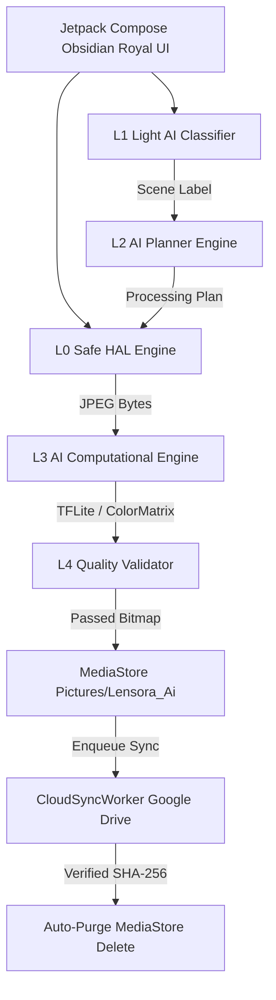
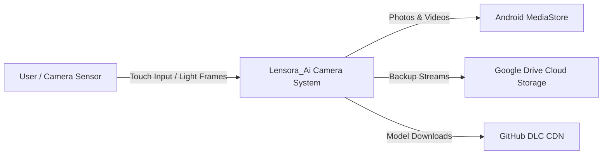
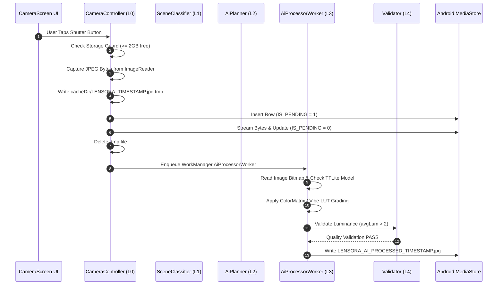

# Architecture & Data Flow Diagrams (DFD) - Lensora_Ai

## 1. System Architecture Overview

Lensora_Ai strictly implements a 5-layer computational camera architecture (L0-L4) designed to decouple low-level Android Camera2 API hardware interactions from high-level Compose UI states and AI inference pipelines.



---

## 2. Layered Component Responsibilities

### L0 Safe Core Engine (`CameraController.kt`)
- Direct Camera2 API HAL wrapper (`CameraDevice`, `CameraCaptureSession`, `CaptureRequest`, `ImageReader`).
- Handles continuous auto-focus, tap-to-focus metering, manual exposure, zoom ratios, and atomic `.tmp` capture journals.
- Guaranteed 100% try-catch safety wrapping around all HAL method calls.

### L1 Light AI Scene Classifier (`SceneClassifier.kt`)
- Runs 500ms (2 FPS) background frame sampling loop on `Dispatchers.Default`.
- Downscales live preview frame to $224 \times 224$ float buffer.
- Outputs real-time scene classification labels (`✨ AI: Portrait`, `✨ AI: Landscape`, `✨ AI: Night`, `✨ AI: Sky`, `✨ AI: Auto`).

### L2 AI Planner Engine (`AiPlanner.kt`)
- Translates `SceneType` semantics into dynamic `ProcessingPlan` objects (`targetEvOffset`, `targetAfMode`).
- Applies exposure compensation steps to Camera2 preview repeating request stream.

### L3 AI Computational Processor (`AiProcessorWorker.kt`)
- WorkManager `CoroutineWorker` executing background computational pass on `Dispatchers.IO`.
- Inspects `filesDir/models/mobilenet_v1_1.0_224.tflite` for TFLite inference or applies scene-type ColorMatrix contrast curves and Vibe LUT color science.

### L4 Quality Validator (`Validator.kt`)
- Verifies target bitmap dimensions and checks average pixel luminance bounds (`avgLum > 2`).
- Prevents corrupt, corrupted, or pitch-black images from reaching MediaStore finalization.

---

## 3. Data Flow Diagrams (DFD)

### 3.1 DFD Level 0: High-Level System Context



### 3.2 DFD Level 1: Atomic Capture & Computational Pipeline Data Flow



---

## 4. Hardware Capability Probe Lab Data Flow

```mermaid
graph TD
    ProbeLab[Probe Lab UI] -->|Audit Request| ProbeEngine[Probe Hardware Engine]
    ProbeEngine -->|Query Characteristics| HAL[Camera2 CameraManager]
    HAL -->|P1: Stream Configuration Map| ProbeEngine
    HAL -->|P2: REQUEST_AVAILABLE_CAPABILITIES_RAW| ProbeEngine
    HAL -->|P3: CONTROL_AE_AVAILABLE_TARGET_FPS_RANGES| ProbeEngine
    ProbeEngine -->|P1 Result| P1[P1 200MP: Binned to 12.5MP]
    ProbeEngine -->|P2 Result| P2[P2 RAW_SENSOR: PASS]
    ProbeEngine -->|P3 Result| P3[P3 24fps Cinema: PASS]

---

## 5. Editor Import Data Flow (`com.lensora.ai.editor.import`)

```mermaid
sequenceDiagram
    autonumber
    participant UI as ProjectsScreen UI
    participant VM as ProjectViewModel
    participant Importer as ProjectImporter
    participant Guard as StorageGuard (StatFs)
    participant MediaStore as System Photo Picker
    participant Disk as Local FilesDir Storage

    UI->>MediaStore: Launch PickMultipleVisualMedia (max 30)
    MediaStore-->>UI: Picked Media URIs
    UI->>VM: startImport(pickedUris, projectName)
    VM->>Importer: importMediaFlow(pickedUris)
    Importer->>Guard: evaluateStorageGuard(availableBytes, requiredBytes)
    alt Storage Low (< Required Bytes)
        Guard-->>Importer: Storage Guard Blocked
        Importer-->>UI: Emit ImportState.StorageBlocked
    else Storage Space Available
        Guard-->>Importer: Storage Guard PASS
        loop For Each Picked URI
            Importer->>Disk: Stream Bytes to filesDir/projects/<id>/media/<clipId>.<ext>.tmp
            Importer->>Disk: Atomic Rename to <clipId>.<ext>
            Importer->>Importer: Extract Duration (MediaMetadataRetriever)
            Importer-->>UI: Emit ImportState.Progress
        end
        Importer->>Disk: Save Project JSON atomically (<id>.json.tmp -> <id>.json)
        Importer-->>UI: Emit ImportState.Success(project)
    end
```
```
